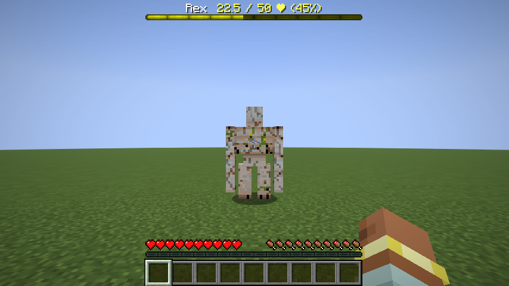

# Dino Health Bar

Rein **clientseitiger Fabric-Mod für Minecraft 1.21.11**. Er zeigt die Herzen von Mobs als Bossbar an,
gedacht für Custom-Dinos mit 3D-Modellen auf Servern, die das Leben nirgends anzeigen.
Auf dem Server muss nichts installiert werden.



## Installation
1. [Fabric Loader](https://fabricmc.net/use/) für 1.21.11 installieren.
2. [Fabric API](https://modrinth.com/mod/fabric-api) (für 1.21.11) in den `mods`-Ordner legen.
3. `dino-healthbar-1.0.0.jar` in den `mods`-Ordner legen.

## Benutzung
- **Anschauen** (bis 24 Blöcke) oder **Schlagen** eines Mobs zeigt die Bossbar:
  `Name  aktuelle Herzen / max. Herzen ❤ (Prozent)`. 1 Herz = 2 Lebenspunkte.
- Die Farbe der Bar ist grün über 50 %, gelb über 25 % und darunter rot.
- Ein getroffenes Mob bleibt 10 s gemerkt, auch wenn du wegschaust. Danach verschwindet die Bar nach 3 s.
- **Taste `H`**: Bar an/aus (änderbar unter Steuerung → „Dino Health Bar“).

### Befehle
| Befehl | Wirkung |
|---|---|
| `/dinobar` | Status |
| `/dinobar toggle` | an/aus |
| `/dinobar debug` | zeigt, was der Mod beim angeschauten Entity sieht (zur Fehlersuche) |
| `/dinobar range <blöcke>` | Anschau-Reichweite (0–64) |
| `/dinobar minhp <lp>` | nur Mobs mit mindestens so viel Max-Leben (z.B. `100`, damit Kühe usw. ignoriert werden) |
| `/dinobar percent` / `name` / `players` | Prozent / Name / andere Spieler ein-/ausblenden |

Alle Einstellungen stehen auch in `config/dinobar.json`.

## Wie es mit 3D-Modellen funktioniert
Modell-Plugins wie ModelEngine bauen einen Dino meist aus einem **unsichtbaren Basis-Mob** (der echte
Lebenspunkte hat) plus Modell-Teilen (Display-, Interaction- oder Armorstand-Entities). Schaust du ein Teil
ohne Leben an, sucht der Mod über Fahrzeug, Passagiere und die nähere Umgebung (2,5 Blöcke) den echten Mob
und zeigt dessen Leben an. Der Name wird vom Mob, von seinem Namensschild-Passagier oder vom Mob-Typ genommen.

**Falls die Bar bei einem Dino nicht oder falsch erscheint:** Schau den Dino an und tippe `/dinobar debug`.
Die Chat-Ausgabe zeigt, welche Entities da sind und welche Lebenswerte der Server schickt.
Manche Server senden absichtlich falsche Lebenswerte an Clients. Dann kann kein Client-Mod das echte Leben kennen.

## Performance
- Pro Tick wird nur **ein** Ziel geprüft, nicht alle Entities der Welt.
- Ein eigener Sicht-Raycast läuft nur alle 2 Ticks und nur, wenn kein Mob direkt im Fadenkreuz ist.
- Die Zuordnung „Modell-Teil → echter Mob“ wird zwischengespeichert.
- Die Bar wird nur neu beschriftet, wenn sich das Leben ändert. Gezeichnet wird sie von der normalen Vanilla-Bossbar.

## Hinweis
Prüfe die Regeln deines Servers zu Client-Mods. Der Mod liest nur Daten, die der Server ohnehin an deinen Client schickt.

## Bauen
```bash
./gradlew build                 # Jar landet in build/libs/
./gradlew test                  # Unit-Tests
xvfb-run -a ./gradlew runClientGameTest   # startet echten Client und testet die Bar
```
